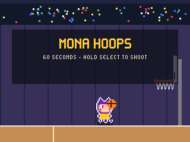
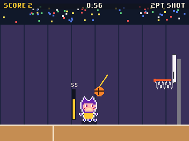
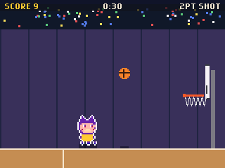
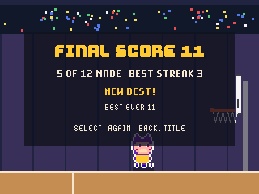

# Mona Hoops for the GitHub Universe 2026 badge

A sixty-second basketball shootout for the GitHub Universe 2026 badge: charge the shot, pick the arc and sink it from spots that keep moving back.

| Title | Charging | On Fire | Results |
| --- | --- | --- | --- |
|  |  |  |  |

Mona is drawn the way the badge's own apps draw her: white outline, purple
fur, peach face, two-pixel eyes and tentacles.

## Install

1. Put the badge in USB Disk Mode (open the Mass Storage app, or double-tap
   RESET) so the `BADGER` volume appears.
2. Copy the `apps/mona_hoops` folder into `BADGER/apps/` (so you end up with
   `BADGER/apps/mona_hoops/__init__.py`).
3. If your badge still runs the stock event menu, its tiles ignore `icon.png`.
   The [hyb26 skill](https://github.com/badger/home/tree/main/.github/skills/hyb26-skill)
   ships `patch_menu_icons.py`, which adds that support (with a backup).
4. Eject the volume. The badge restarts into the menu with a Mona Hoops tile.

Scores are saved under `/state`. No network or extra hardware is needed.

## Controls

| Button | Action |
| --- | --- |
| Select | Hold to charge the power meter, release to shoot; start; play again |
| Up / Down | Raise or lower the arc, 35 to 70 degrees |
| Back | Back to the title |

## How it works

- The ball is a simple projectile under gravity; it bounces off the backboard and the two ends of the rim with damping, and a basket counts when it crosses the rim line downward between them.
- Each shot moves Mona to the next of six spots; the far three are worth three points. A swish (no rim or board contact) earns a bonus and three makes in a row set the ball on fire for another.
- The clock starts with the first shot and runs sixty seconds; the badge keeps the best score and total makes.

The sprites are drawn from pixel maps by `tools/build_sprites.py`
(`python3 tools/build_sprites.py hoops apps/mona_hoops/assets`).

## Tools

- `tools/build_sprites.py` regenerates the sprite sheets.
- `tools/badge_harness.py` (with `tools/badge_kit.py` copied to `/state/kit.py`
  on the badge) drives the app's frame loop on a real badge over `mpremote
  run`, simulating button presses and saving run-length encoded screenshots
  to `/state/shots`; `tools/rle2png.py` converts them.

Mona is GitHub's Octocat mascot; this is a fan project and not affiliated
with GitHub.
